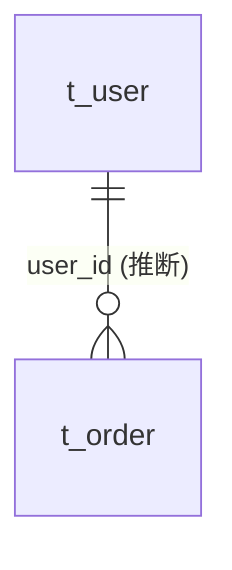

# demo-shop 数据库设计文档

| 项目 | 内容 |
|---|---|
| 版本 | 1.3.0 |
| 数据库 | MySQL（`mysql-connector-java`，InnoDB）。版本【待确认】 |
| 字符集 | utf8mb4 |
| 表数量 | 3 |
| 数据来源 | `src/main/resources/db/schema.sql`，并与实体类 `User`、`Order` 交叉核对 |

## 1. 设计约定

- 主键：`t_user` 使用自增（`AUTO_INCREMENT` / `IdType.AUTO`）；`t_order` 使用雪花 ID（`IdType.ASSIGN_ID`），由应用生成
- 逻辑删除：字段 `deleted`，0 正常 1 删除（`BaseEntity` 上的 `@TableLogic`，mybatis-plus 全局配置 `logic-delete-field: deleted`）
- 审计字段：`create_time` 插入时自动填充，`update_time` 插入和更新时自动填充（`@TableField(fill = ...)`）
- 乐观锁：`t_order.version`（`@Version`）

## 2. 表清单

| 序号 | 表名 | 说明 | 对应实体 |
|---|---|---|---|
| 1 | t_user | 用户表 | `User` |
| 2 | t_order | 订单表 | `Order` |
| 3 | t_operation_log | 【待确认：DDL 无注释，按表名理解为操作日志】 | 无 |

## 3. 表结构

### 3.1 t_user 用户表

| 字段名 | 类型 | 允许空 | 默认值 | 主键 | 说明 |
|---|---|---|---|---|---|
| id | bigint | 否 |  | 是 | 主键，自增 |
| username | varchar(32) | 否 |  |  | 用户名 |
| password | varchar(100) | 否 |  |  | 密码(BCrypt) |
| mobile | varchar(11) | 是 | NULL |  | 手机号 |
| status | tinyint | 否 | 1 |  | 状态 1 启用 0 禁用 |
| create_time | datetime | 否 | CURRENT_TIMESTAMP |  | 创建时间 |
| update_time | datetime | 是 | NULL |  | 更新时间（ON UPDATE CURRENT_TIMESTAMP） |
| deleted | tinyint | 否 | 0 |  | 逻辑删除 0 正常 1 删除 |

**索引**

| 索引名 | 类型 | 字段 |
|---|---|---|
| PRIMARY | 主键 | id |
| uk_username | 唯一 | username |

### 3.2 t_order 订单表

| 字段名 | 类型 | 允许空 | 默认值 | 主键 | 说明 |
|---|---|---|---|---|---|
| id | bigint | 否 |  | 是 | 主键(雪花ID) |
| order_no | varchar(32) | 否 |  |  | 订单号 |
| user_id | bigint | 否 |  |  | 下单用户 |
| amount | decimal(10,2) | 否 |  |  | 订单金额 |
| status | int | 否 |  |  | 订单状态 10待支付 20已支付 30已发货 -1已取消 |
| version | int | 否 | 0 |  | 乐观锁 |
| create_time | datetime | 否 | CURRENT_TIMESTAMP |  | 创建时间（DDL 无注释，取自实体 `BaseEntity`） |
| update_time | datetime | 是 | NULL |  | 更新时间（DDL 无注释，取自实体 `BaseEntity`） |
| deleted | tinyint | 否 | 0 |  | 逻辑删除 0 正常 1 删除（DDL 无注释，取自实体 `BaseEntity`） |

**索引**

| 索引名 | 类型 | 字段 |
|---|---|---|
| PRIMARY | 主键 | id |
| idx_user | 普通 | user_id |

> `order_no` 没有唯一索引。【待确认：订单号是否需要唯一约束】

### 3.3 t_operation_log

| 字段名 | 类型 | 允许空 | 默认值 | 主键 | 说明 |
|---|---|---|---|---|---|
| id | bigint | 否 |  | 是 | 自增主键【待确认：DDL 无注释】 |
| content | text | 是 | NULL |  | 【待确认：DDL 无注释】 |

**索引**

| 索引名 | 类型 | 字段 |
|---|---|---|
| PRIMARY | 主键 | id |

## 4. 表关系

- `t_order.user_id` → `t_user.id`：**推断**。依据是字段命名，以及 DDL 注释“下单用户”。数据库没有外键约束，代码中也没有 JPA 关联注解。
- `t_operation_log` 与其他表没有可识别的关联。

## 5. 一致性检查

| 问题 | 说明 |
|---|---|
| 表无对应实体 | `t_operation_log` 在 DDL 中存在，但代码中没有对应实体类。【待确认：是否废弃表，或由其他服务写入】 |
| 非表字段 | `User.roleName` 标注了 `@TableField(exist = false)`，不对应数据库列，属正常情况 |

其余字段的实体定义与 DDL 一致。

## 附录：待确认事项

| # | 位置 | 事项 | 建议确认人 |
|---|---|---|---|
| 1 | 头部 | MySQL 版本 | 运维 |
| 2 | 3.2 | `order_no` 是否需要唯一索引 | 开发 |
| 3 | 3.3 / 5 | `t_operation_log` 的用途、字段含义、是否仍在使用 | 开发 |
