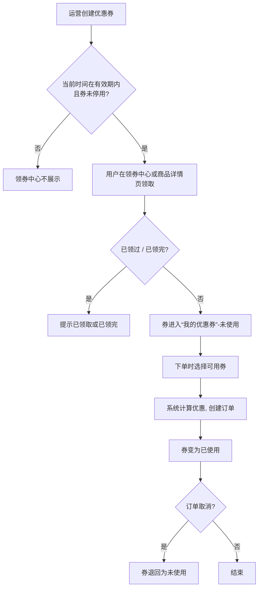
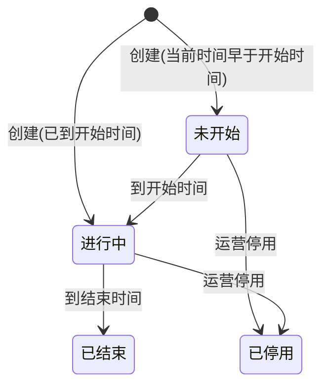
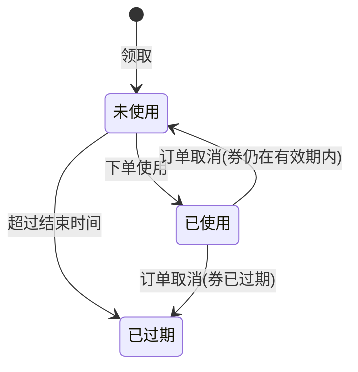
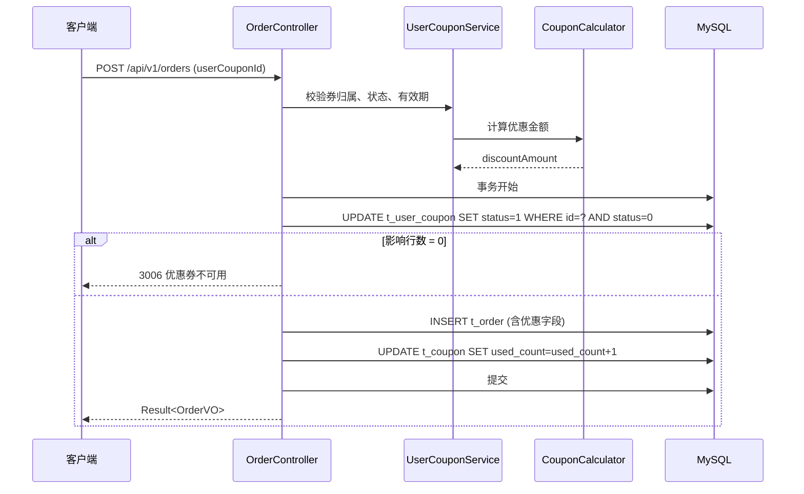

# 优惠券 详细设计

| 项目 | 内容 |
|---|---|
| 版本 | v0.1（评审稿） |
| 需求来源 | 《商城优惠券功能需求说明书 V1.0》，运营部，2026-10-20 |
| 所属系统 | demo-shop 1.3.0 |
| 编写日期 | 2026-10-31 |
| 状态 | 待评审 |

## 修订记录

| 版本 | 日期 | 说明 |
|---|---|---|
| v0.1 | 2026-10-31 | 初稿，待需求评审 |

---

# 第一部分 业务确认

> 本部分供运营部确认。请重点查看 **1.5 待澄清问题**（其中 6 个阻塞开发），并逐条核对 **1.2 需求清单** 和 **1.4 验收标准** 是否符合预期。文中标注【假设，见 Q-xx】的内容是按建议方案写的，答复不同时会相应修改。

## 1.1 背景与目标

双十二大促需要用优惠券拉动下单转化。系统目前没有任何优惠能力，要求 **12 月 5 日前上线**。

**范围内**：后台创建、查询、停用优惠券；用户领券；下单用券；我的优惠券；订单取消退券；券的领取与使用统计。

**范围外**（本期不做，如需要请在评审时提出）：
- 按商品、品类限定可用范围【假设，见 Q-01】
- 后台直接发券给指定用户、兑换码
- 退款、售后退券（系统目前没有退款流程）【假设，见 Q-06】
- 统计报表导出【假设，见 Q-09】

## 1.2 需求清单

| 编号 | 需求描述 | 角色 | 来源 | 优先级 |
|---|---|---|---|---|
| R-01 | 运营可以创建优惠券，类型为满减券或折扣券，填写名称、面额或折扣、使用门槛、发放总量、有效期 | 运营 | 需求 2.1 | 必须 |
| R-02 | 运营可以查看优惠券列表 | 运营 | 需求 2.1 | 必须 |
| R-03 | 运营可以停用优惠券，停用后用户不能再领取 | 运营 | 需求 2.1 | 必须 |
| R-04 | 用户可以领取优惠券，每张券每人限领一张，发放总量领完后不能再领 | 用户 | 需求 2.2 | 必须 |
| R-05 | 领券中心展示当前可领取的优惠券，并标明用户是否已领取 | 用户 | 需求 2.2（推导） | 必须 |
| R-06 | 商品详情页展示当前可领取的优惠券 | 用户 | 需求 2.2，见 Q-01 | 必须 |
| R-07 | 用户下单时可以看到本单可用的优惠券并选择一张 | 用户 | 需求 2.3，见 Q-04 | 必须 |
| R-08 | 用券下单时，系统按券规则计算优惠金额和实付金额 | 系统 | 需求 2.3 | 必须 |
| R-09 | 用户在个人中心按“未使用、已使用、已过期”查看自己的优惠券 | 用户 | 需求 2.4 | 必须 |
| R-10 | 订单取消后，该订单使用的优惠券退回给用户 | 系统 | 需求 3 | 必须 |
| R-11 | 运营可以查看每张券的领取数量和使用数量 | 运营 | 需求 3 | 必须 |

## 1.3 业务规则与流程

### 1.3.1 业务流程



### 1.3.2 业务规则

| 规则 | 内容 | 关联需求 |
|---|---|---|
| 券类型 | 满减券：满门槛金额减固定金额，例如满 100 减 10。折扣券：满门槛金额按折扣计算，例如满 50 打 8.5 折 | R-01 |
| 适用范围 | 全场商品通用【假设，见 Q-01】 | R-01, R-06 |
| 有效期 | 固定起止时间，例如 2026-12-10 00:00:00 至 2026-12-12 23:59:59，领取和使用都必须在有效期内【假设，见 Q-03】 | R-01, R-04 |
| 门槛判定 | 订单商品金额 **大于或等于** 门槛金额时可用。门槛为 0 表示无门槛【假设，见 Q-02】 | R-07, R-08 |
| 折扣上限 | 折扣券可设置“最高优惠金额”，不设则不封顶【假设，见 Q-02】 | R-01, R-08 |
| 金额精度 | 优惠金额精确到分，折扣券计算结果向下取整到分【假设，见 Q-08】 | R-08 |
| 最低实付 | 优惠后实付金额最低 0.01 元【假设，见 Q-10】 | R-08 |
| 叠加 | 一个订单最多使用一张优惠券【假设，见 Q-04】 | R-07 |
| 限领 | 每张券每人限领一张；券退回后仍算已领，不能重复领取【假设，见 Q-05】 | R-04, R-10 |
| 领完 | 已领取数量达到发放总量后不能再领。用券或退券不影响已领取数量 | R-04 |
| 停用 | 停用后不能再领取；已领取未使用的券在有效期内仍可使用【假设，见 Q-07】 | R-03 |
| 修改 | 优惠券创建后不能修改，只能停用【假设，见 Q-11】 | R-01 |
| 退券 | 仅“未支付订单取消”时退券；退回时如果券已过期，就直接显示为已过期【假设，见 Q-06】 | R-10 |

### 1.3.3 状态说明

**优惠券（运营视角）**



| 状态 | 含义 | 允许的操作 |
|---|---|---|
| 未开始 | 未到开始时间 | 停用 |
| 进行中 | 在有效期内且未停用 | 用户领取、使用；运营停用 |
| 已结束 | 已过结束时间 | 仅查看 |
| 已停用 | 运营已停用 | 仅查看；用户已领的券仍可使用【假设，见 Q-07】 |

**用户的券**



| 状态 | 含义 | 允许的操作 |
|---|---|---|
| 未使用 | 已领取，在有效期内，未使用 | 下单时选择 |
| 已使用 | 已用于某个订单 | 查看对应订单 |
| 已过期 | 超过结束时间未使用 | 仅查看 |

### 1.3.4 角色与权限

| 角色 | 可执行操作 | 数据范围 |
|---|---|---|
| 运营 | 创建、查看、停用优惠券，查看领取和使用统计 | 全部优惠券 |
| 用户 | 领券、用券、查看自己的券 | 仅本人的券 |

后台接口的登录与权限校验方式见 Q-12。

### 1.3.5 页面与字段

**后台 - 创建优惠券**

| 字段 | 必填 | 校验规则 | 说明 |
|---|---|---|---|
| 券名称 | 是 | 1–30 字 | 展示给用户 |
| 券类型 | 是 | 满减券 / 折扣券 | |
| 减免金额 | 满减券必填 | 0.01–9999.99 元 | |
| 折扣 | 折扣券必填 | 0.1–9.9 折，最多一位小数 | 例如 8.5 表示 8.5 折 |
| 最高优惠金额 | 否 | 0.01–9999.99 元，仅折扣券 | 【假设，见 Q-02】 |
| 使用门槛 | 是 | 0–99999.99 元，0 表示无门槛 | 满减券的减免金额必须小于门槛（无门槛除外） |
| 发放总量 | 是 | 1–1000000 张 | |
| 有效期 | 是 | 结束时间晚于开始时间，且晚于当前时间 | 【假设，见 Q-03】 |

**后台 - 优惠券列表**：名称、类型、优惠内容（如“满100减10”）、有效期、状态、发放总量、已领取、已使用。可按名称、状态筛选，按创建时间倒序，每页 10 条。【假设，见 Q-09】

**领券中心、商品详情页**：展示进行中、未领完的券。每张券显示优惠内容、门槛、有效期，以及“领取”“已领取”或“已领完”。

**我的优惠券**：未使用、已使用、已过期三个页签。未使用按到期时间正序排列，即将过期的排在前面。

**下单页**：展示本单可用的券，默认不选，用户手动选择一张。不可用的券不展示。【假设，见 Q-04】

### 1.3.6 异常场景

| 场景 | 系统行为 | 用户看到的提示 |
|---|---|---|
| 重复领取 | 拒绝 | 您已领取过该优惠券 |
| 最后几张被同时抢领 | 只有发放总量内的请求成功，不会超发 | 优惠券已领完 |
| 领取已停用或已结束的券 | 拒绝 | 优惠券已失效 |
| 下单时券已过期或已被使用 | 拒绝下单，用户需重新选择 | 优惠券不可用，请重新选择 |
| 下单时订单金额未达门槛 | 拒绝下单 | 未达到优惠券使用门槛 |
| 同一张券同时用于两个订单 | 只有一个订单成功 | 优惠券不可用，请重新选择 |

## 1.4 验收标准

| 编号 | 关联需求 | 前置条件 | 操作 | 预期结果 |
|---|---|---|---|---|
| AC-01 | R-01 | 运营已登录 | 创建“满100减10”、总量 100、有效期为明天到下周的满减券 | 创建成功，列表中显示状态“未开始” |
| AC-02 | R-01 | 运营已登录 | 创建 8.5 折、最高优惠 20 元、门槛 50 的折扣券 | 创建成功，优惠内容显示“满50打8.5折，最高减20” |
| AC-03 | R-01 | 运营已登录 | 创建满减券，门槛 50，减免 60 | 创建失败，提示减免金额必须小于门槛 |
| AC-04 | R-02, R-11 | 已有 3 张券，其中一张被领 5 次、用 2 次 | 打开优惠券列表 | 显示 3 张券；该券已领取 5、已使用 2 |
| AC-05 | R-03 | 有一张进行中的券，用户 A 已领未用 | 运营停用该券 | 领券中心不再展示；用户 A 仍可在有效期内使用 |
| AC-06 | R-04 | 进行中的券，总量 2 | 用户 A 领取 | 成功，A 的未使用券中出现该券 |
| AC-07 | R-04 | 用户 A 已领该券 | A 再次领取 | 失败，提示“您已领取过该优惠券” |
| AC-08 | R-04 | 券总量 2，已领 1 | 用户 B 和 C 同时领取 | 只有一人成功，另一人提示“优惠券已领完”；已领取数为 2 |
| AC-09 | R-05 | 有进行中、未开始、已停用、已领完各一张券 | 用户打开领券中心 | 只展示进行中且未领完的券；已领过的显示“已领取” |
| AC-10 | R-06 | 同 AC-09 | 用户打开任一商品详情页 | 展示的券与领券中心一致 |
| AC-11 | R-07 | 用户有门槛 100 和门槛 200 两张未使用的券 | 下单，商品金额 150 | 可选列表只有门槛 100 的券 |
| AC-12 | R-07 | 用户有门槛 100 的券 | 下单，商品金额恰好 100 | 该券可选（边界：等于门槛可用） |
| AC-13 | R-08 | 满 100 减 10 的券 | 商品金额 120 用券下单 | 优惠 10.00，实付 110.00，券变为已使用 |
| AC-14 | R-08 | 8.5 折、最高优惠 20 的券 | 商品金额 99.99 用券下单 | 优惠 14.99（99.99×0.15=14.9985，向下取整），实付 85.00 |
| AC-15 | R-08 | 同上 | 商品金额 200 用券下单 | 优惠 20.00（封顶），实付 180.00 |
| AC-16 | R-08 | 无门槛减 10 元的券 | 商品金额 5 用券下单 | 优惠 4.99，实付 0.01 |
| AC-17 | R-09 | 用户有未使用、已使用、已过期的券各一张 | 打开我的优惠券并切换三个页签 | 每个页签各显示对应的一张 |
| AC-18 | R-10 | 用券下单后未支付，券仍在有效期内 | 取消订单 | 券回到“未使用” |
| AC-19 | R-10 | 用券下单后未支付，券已过结束时间 | 取消订单 | 券显示在“已过期” |

## 1.5 待澄清问题

| 编号 | 问题 | 选项 | 建议 | 影响 | 类型 | 状态 |
|---|---|---|---|---|---|---|
| Q-01 | 优惠券适用于哪些商品？ | A 全场通用<br>B 可指定商品或品类 | A。B 需要建关联表并改造商品详情页，12 月 5 日前风险高，可放到二期 | R-01, R-06，表结构 | 阻塞 | 待确认 |
| Q-02 | 门槛和折扣上限：订单金额等于门槛时能否使用？折扣券是否需要“最高优惠金额”？ | A 等于门槛可用，折扣券可设封顶<br>B 等于门槛可用，不设封顶<br>C 必须超过门槛 | A。不设封顶时，高客单订单的优惠成本不可控 | R-01, R-08，表结构 | 阻塞 | 待确认 |
| Q-03 | 有效期的形式？ | A 固定起止时间<br>B 领取后 N 天内有效<br>C 两种都支持 | A。大促券通常是固定时间段；B 和 C 需要按用户计算到期时间 | R-01, R-09，表结构 | 阻塞 | 待确认 |
| Q-04 | 一个订单可以用几张券？ | A 最多 1 张<br>B 满减券和折扣券各 1 张<br>C 不限 | A。多张券需要定计算顺序和分摊规则，对账复杂 | R-07, R-08，表结构 | 阻塞 | 待确认 |
| Q-05 | “每人限领一张”是指每张券每人一张，还是活动期间所有券合计一张？券退回后能否再领？ | A 每张券每人 1 张，退回不影响<br>B 所有券合计每人 1 张 | A | R-04 | 非阻塞 | 待确认 |
| Q-06 | 哪些情况算“订单取消”需要退券？另外，系统目前没有取消订单的功能（有“已取消”状态，但没有取消入口），取消功能是否在本期范围内？ | A 本期只做未支付订单取消（含超时自动取消），退券随之实现<br>B 未支付取消和已支付退款都退券 | A。系统目前没有退款流程，B 依赖退款功能。取消入口和超时时长请一并确认 | R-10，工作量 | 阻塞 | 待确认 |
| Q-07 | 运营停用券后，用户已领未用的券还能用吗？ | A 能用到过期<br>B 立即失效 | A。B 会让已领券的用户投诉 | R-03 | 非阻塞 | 待确认 |
| Q-08 | 折扣券优惠金额的分以下部分怎么处理？ | A 向下取整（用户少优惠不到 1 分）<br>B 四舍五入 | A。可以避免优惠超出折扣设定 | R-08 | 非阻塞 | 待确认 |
| Q-09 | “统计每张券的领取和使用情况”需要到什么程度？ | A 列表中显示已领取数和已使用数<br>B 另做报表，按日统计并可导出 | A。B 可以二期做 | R-11 | 非阻塞 | 待确认 |
| Q-10 | 无门槛券面额大于订单金额时怎么处理？ | A 优惠到实付 0.01 元为止<br>B 不允许使用<br>C 可以 0 元下单 | A。0 元订单会走不通支付流程 | R-08 | 非阻塞 | 待确认 |
| Q-11 | 券创建后能否修改？ | A 不能修改，只能停用<br>B 未开始前可以修改全部内容<br>C 可随时追加发放总量 | A。已领出去的券改规则会引起纠纷；如需追加总量可选 C | R-01 | 非阻塞 | 待确认 |
| Q-12 | （技术负责人确认）后台接口如何鉴权、如何识别运营身份？代码中没有认证机制，现有接口通过请求头 `X-User-Id` 识别用户 | A 网关统一鉴权，后台接口统一使用 `/api/v1/admin/` 前缀<br>B 本期在服务内增加登录鉴权 | A，与现有做法一致。B 会额外增加较大工作量 | 全部后台接口 | 阻塞 | 待确认 |

---

# 第二部分 技术设计

## 2.1 总体设计

**涉及模块**

| 类型 | 新增 | 修改 |
|---|---|---|
| Controller | `AdminCouponController`、`CouponController`、`UserCouponController` | `OrderController`（创建订单） |
| Service | `CouponService`、`UserCouponService`、`CouponCalculator` | 订单创建逻辑 |
| Entity | `Coupon`、`UserCoupon` | `Order`（新增 3 个字段） |
| Enum | `CouponType`、`UserCouponStatus` | |
| DTO/VO | `CouponCreateDTO`、`CouponQuery`、`CouponVO`、`AdminCouponVO`、`UserCouponVO` | `OrderCreateRequest`、`OrderVO` |

**遵循的现有约定**（来自代码调研）
- 统一返回 `Result<T>`，分页返回 `PageResult<T>`
- 路径前缀 `/api/v1/`；用户身份取请求头 `X-User-Id`（与 `POST /api/v1/orders` 一致）
- 表名前缀 `t_`；实体继承 `BaseEntity`（`create_time`、`update_time`、`deleted` 自动填充与逻辑删除）
- 主键使用雪花 ID（`IdType.ASSIGN_ID`），与 `t_order` 一致
- 校验使用 `javax.validation` 注解；错误码沿用 `Result.code`，本功能使用 3001–3099

**代码依据**：`common/Result.java`、`common/PageResult.java`、`common/BaseEntity.java`、`entity/Order.java`、`controller/OrderController.java`、`dto/OrderCreateRequest.java`、`resources/db/schema.sql`。代码中没有优惠券相关实现，也没有取消订单的入口（见 Q-06）。

**下单用券时序**（R-07, R-08）



## 2.2 数据库设计

### 2.2.1 表清单

| 表名 | 说明 | 变更类型 | 关联需求 |
|---|---|---|---|
| `t_coupon` | 优惠券模板 | 新增 | R-01, R-02, R-03, R-11 |
| `t_user_coupon` | 用户领取的券 | 新增 | R-04, R-05, R-09, R-10 |
| `t_order` | 订单表 | 修改 | R-08, R-10 |

### 2.2.2 表结构

#### `t_coupon` 优惠券模板（新增）

| 字段 | 类型 | 允许空 | 默认值 | 说明 |
|---|---|---|---|---|
| id | bigint | 否 | | 主键，雪花 ID |
| name | varchar(30) | 否 | | 券名称 |
| type | tinyint | 否 | | 1 满减券，2 折扣券 |
| threshold_amount | decimal(10,2) | 否 | 0.00 | 使用门槛，0 表示无门槛 |
| reduce_amount | decimal(10,2) | 是 | | 满减券减免金额 |
| discount | decimal(3,1) | 是 | | 折扣券折扣，8.5 表示 8.5 折 |
| max_discount_amount | decimal(10,2) | 是 | | 折扣券最高优惠金额，空表示不封顶【假设，见 Q-02】 |
| total_count | int | 否 | | 发放总量 |
| received_count | int | 否 | 0 | 已领取数量 |
| used_count | int | 否 | 0 | 已使用数量 |
| start_time | datetime | 否 | | 有效期开始【假设，见 Q-03】 |
| end_time | datetime | 否 | | 有效期结束 |
| status | tinyint | 否 | 1 | 1 启用，0 停用 |
| create_time | datetime | 否 | CURRENT_TIMESTAMP | 创建时间 |
| update_time | datetime | 是 | | 更新时间 |
| deleted | tinyint | 否 | 0 | 逻辑删除 |

索引：`idx_status_time (status, end_time)`，供领券中心查询进行中的券。

#### `t_user_coupon` 用户领取的券（新增）

| 字段 | 类型 | 允许空 | 默认值 | 说明 |
|---|---|---|---|---|
| id | bigint | 否 | | 主键，雪花 ID |
| coupon_id | bigint | 否 | | 优惠券 ID |
| user_id | bigint | 否 | | 用户 ID |
| status | tinyint | 否 | 0 | 0 未使用，1 已使用。“已过期”不落库，见 D-03 |
| order_id | bigint | 是 | | 使用该券的订单 |
| receive_time | datetime | 否 | | 领取时间 |
| use_time | datetime | 是 | | 使用时间 |
| create_time | datetime | 否 | CURRENT_TIMESTAMP | 创建时间 |
| update_time | datetime | 是 | | 更新时间 |
| deleted | tinyint | 否 | 0 | 逻辑删除（本表不做删除，保留与 BaseEntity 一致） |

索引：
- `uk_coupon_user (coupon_id, user_id)` 唯一索引，保证每人限领一张（D-01）
- `idx_user_status (user_id, status)`，供我的优惠券和下单可用券查询

#### `t_order` 订单表（修改）

| 字段 | 类型 | 允许空 | 默认值 | 说明 |
|---|---|---|---|---|
| user_coupon_id | bigint | 是 | | 使用的用户券 ID，未用券为空【假设，见 Q-04】 |
| original_amount | decimal(10,2) | 否 | 0.00 | 商品金额（优惠前） |
| discount_amount | decimal(10,2) | 否 | 0.00 | 优惠金额 |

现有 `amount` 字段含义不变，仍为实付金额：`amount = original_amount - discount_amount`。

### 2.2.3 DDL

```sql
CREATE TABLE `t_coupon` (
  `id` bigint NOT NULL COMMENT '主键(雪花ID)',
  `name` varchar(30) NOT NULL COMMENT '券名称',
  `type` tinyint NOT NULL COMMENT '1满减券 2折扣券',
  `threshold_amount` decimal(10,2) NOT NULL DEFAULT '0.00' COMMENT '使用门槛,0无门槛',
  `reduce_amount` decimal(10,2) DEFAULT NULL COMMENT '满减金额',
  `discount` decimal(3,1) DEFAULT NULL COMMENT '折扣,8.5表示8.5折',
  `max_discount_amount` decimal(10,2) DEFAULT NULL COMMENT '折扣券最高优惠金额',
  `total_count` int NOT NULL COMMENT '发放总量',
  `received_count` int NOT NULL DEFAULT 0 COMMENT '已领取数量',
  `used_count` int NOT NULL DEFAULT 0 COMMENT '已使用数量',
  `start_time` datetime NOT NULL COMMENT '有效期开始',
  `end_time` datetime NOT NULL COMMENT '有效期结束',
  `status` tinyint NOT NULL DEFAULT 1 COMMENT '1启用 0停用',
  `create_time` datetime NOT NULL DEFAULT CURRENT_TIMESTAMP COMMENT '创建时间',
  `update_time` datetime DEFAULT NULL COMMENT '更新时间',
  `deleted` tinyint NOT NULL DEFAULT '0' COMMENT '逻辑删除',
  PRIMARY KEY (`id`),
  KEY `idx_status_time` (`status`, `end_time`)
) ENGINE=InnoDB DEFAULT CHARSET=utf8mb4 COMMENT='优惠券模板';

CREATE TABLE `t_user_coupon` (
  `id` bigint NOT NULL COMMENT '主键(雪花ID)',
  `coupon_id` bigint NOT NULL COMMENT '优惠券ID',
  `user_id` bigint NOT NULL COMMENT '用户ID',
  `status` tinyint NOT NULL DEFAULT 0 COMMENT '0未使用 1已使用',
  `order_id` bigint DEFAULT NULL COMMENT '使用的订单ID',
  `receive_time` datetime NOT NULL COMMENT '领取时间',
  `use_time` datetime DEFAULT NULL COMMENT '使用时间',
  `create_time` datetime NOT NULL DEFAULT CURRENT_TIMESTAMP COMMENT '创建时间',
  `update_time` datetime DEFAULT NULL COMMENT '更新时间',
  `deleted` tinyint NOT NULL DEFAULT '0' COMMENT '逻辑删除',
  PRIMARY KEY (`id`),
  UNIQUE KEY `uk_coupon_user` (`coupon_id`, `user_id`),
  KEY `idx_user_status` (`user_id`, `status`)
) ENGINE=InnoDB DEFAULT CHARSET=utf8mb4 COMMENT='用户优惠券';

ALTER TABLE `t_order`
  ADD COLUMN `user_coupon_id` bigint DEFAULT NULL COMMENT '使用的用户券ID' AFTER `user_id`,
  ADD COLUMN `original_amount` decimal(10,2) NOT NULL DEFAULT '0.00' COMMENT '商品金额(优惠前)' AFTER `user_coupon_id`,
  ADD COLUMN `discount_amount` decimal(10,2) NOT NULL DEFAULT '0.00' COMMENT '优惠金额' AFTER `original_amount`;

-- 存量订单：商品金额 = 实付金额
UPDATE `t_order` SET `original_amount` = `amount` WHERE `original_amount` = 0;
```

## 2.3 接口设计

### 2.3.1 接口清单

| 接口 | 说明 | 调用方 | 关联需求 |
|---|---|---|---|
| `POST /api/v1/admin/coupons` | 创建优惠券 | 管理后台 | R-01 |
| `GET /api/v1/admin/coupons` | 优惠券列表（含领取、使用统计） | 管理后台 | R-02, R-11 |
| `PUT /api/v1/admin/coupons/{id}/disable` | 停用优惠券 | 管理后台 | R-03 |
| `GET /api/v1/coupons/available` | 可领取的券（领券中心、商品详情页） | 用户端 | R-05, R-06 |
| `POST /api/v1/coupons/{id}/receive` | 领取优惠券 | 用户端 | R-04 |
| `GET /api/v1/user-coupons` | 我的优惠券 | 用户端 | R-09 |
| `GET /api/v1/user-coupons/usable` | 本单可用的券 | 用户端下单页 | R-07 |
| `POST /api/v1/orders` | 创建订单（**修改**：新增用券参数） | 用户端 | R-08 |

后台接口统一使用 `/api/v1/admin/` 前缀，由网关鉴权【假设，见 Q-12】。用户端接口通过请求头 `X-User-Id` 识别用户。

**新增错误码**

| 错误码 | 含义 | 关联需求 |
|---|---|---|
| 3001 | 优惠券参数不合法（如满减金额不小于门槛） | R-01 |
| 3002 | 优惠券不存在 | R-03, R-04 |
| 3003 | 优惠券已失效（停用、未开始或已结束） | R-04 |
| 3004 | 您已领取过该优惠券 | R-04 |
| 3005 | 优惠券已领完 | R-04 |
| 3006 | 优惠券不可用，请重新选择 | R-08 |
| 3007 | 未达到优惠券使用门槛 | R-08 |

### 2.3.2 接口详情

#### 创建优惠券 `POST /api/v1/admin/coupons`

请求体 `CouponCreateDTO`：

| 字段 | 类型 | 必填 | 校验 | 说明 |
|---|---|---|---|---|
| name | String | 是 | `@NotBlank @Size(max=30)` | 券名称 |
| type | Integer | 是 | 1 或 2 | 券类型 |
| reduceAmount | BigDecimal | 满减券必填 | 0.01–9999.99 | 减免金额 |
| discount | BigDecimal | 折扣券必填 | 0.1–9.9，1 位小数 | 折扣 |
| maxDiscountAmount | BigDecimal | 否 | 0.01–9999.99 | 最高优惠金额 |
| thresholdAmount | BigDecimal | 是 | 0–99999.99 | 门槛 |
| totalCount | Integer | 是 | 1–1000000 | 发放总量 |
| startTime | String | 是 | `yyyy-MM-dd HH:mm:ss` | 开始时间 |
| endTime | String | 是 | 晚于 startTime 和当前时间 | 结束时间 |

类型相关的交叉校验在 Service 中完成，失败返回 3001。响应 `Result<Long>`，data 为券 ID。

#### 优惠券列表 `GET /api/v1/admin/coupons`

查询参数：`pageNum`（默认 1）、`pageSize`（默认 10）、`name`（模糊）、`state`（NOT_STARTED / ONGOING / ENDED / DISABLED）。

响应 `Result<PageResult<AdminCouponVO>>`：在券的全部字段基础上，增加 `state`（由 status 与当前时间计算）、`receivedCount`、`usedCount`、`displayText`（如“满100减10”）。

#### 停用优惠券 `PUT /api/v1/admin/coupons/{id}/disable`

幂等：对已停用的券再次停用返回成功。响应 `Result<Void>`。

#### 可领取的券 `GET /api/v1/coupons/available`

请求头 `X-User-Id`（选填，未登录时不返回领取状态）。返回状态为启用、在有效期内、`received_count < total_count` 的券，按结束时间正序。

响应 `Result<List<CouponVO>>`：`id`、`name`、`type`、`displayText`、`thresholdAmount`、`startTime`、`endTime`、`received`（Boolean，当前用户是否已领）。

#### 领取优惠券 `POST /api/v1/coupons/{id}/receive`

请求头 `X-User-Id` 必填。处理逻辑见 2.4.1。响应 `Result<Long>`，data 为用户券 ID。错误码 3002–3005。

#### 我的优惠券 `GET /api/v1/user-coupons`

请求头 `X-User-Id`；查询参数 `status`：UNUSED / USED / EXPIRED（必填），以及 `pageNum`、`pageSize`。

响应 `Result<PageResult<UserCouponVO>>`：`id`、`couponId`、`name`、`displayText`、`thresholdAmount`、`startTime`、`endTime`、`status`、`orderId`、`useTime`。

#### 本单可用的券 `GET /api/v1/user-coupons/usable`

请求头 `X-User-Id`；查询参数 `amount`（BigDecimal，必填，本单商品金额）。返回未使用、在有效期内、门槛 ≤ amount 的券，每张带上 `discountAmount`（按本单金额计算的优惠），按优惠金额倒序。

#### 创建订单 `POST /api/v1/orders`（修改）

`OrderCreateRequest` 新增字段：

| 字段 | 类型 | 必填 | 说明 |
|---|---|---|---|
| userCouponId | Long | 否 | 使用的用户券 ID |

`OrderVO` 新增字段：`originalAmount`、`discountAmount`。原 `amount` 仍为实付金额，兼容老客户端。

## 2.4 关键逻辑

### 2.4.1 领券（R-04）

```sql
-- 1. 校验券状态与有效期（应用层），失败返回 3002 / 3003
-- 2. 扣减库存：条件更新，防止超发
UPDATE t_coupon SET received_count = received_count + 1
 WHERE id = ? AND status = 1 AND received_count < total_count
   AND NOW() BETWEEN start_time AND end_time AND deleted = 0;
-- 影响行数 0 → 3005（或复查后 3003）
-- 3. 插入 t_user_coupon；唯一索引冲突 (DuplicateKeyException) → 回滚事务，返回 3004
```

第 2、3 步在同一事务中执行。先扣库存、后插记录：重复领取时唯一索引冲突会让整个事务回滚，库存不会被错扣。

### 2.4.2 优惠计算（R-08）`CouponCalculator`

```
满减券：discount = min(reduce_amount, original - 0.01)
折扣券：raw = original × (10 - discount) / 10
        discount = floor(raw, 2位小数)            【假设，见 Q-08】
        if max_discount_amount != null: discount = min(discount, max_discount_amount)
        discount = min(discount, original - 0.01)  【假设，见 Q-10】
门槛：original >= threshold_amount               【假设，见 Q-02】
```

计算统一使用 `BigDecimal`，舍入模式为 `RoundingMode.DOWN`。`GET /api/v1/user-coupons/usable` 和下单都调用同一个方法，保证展示的优惠与实际一致。

### 2.4.3 下单用券（R-08）

见 2.1 时序图。并发下同一张券被两个订单使用时，依靠 `UPDATE ... WHERE status = 0` 的影响行数判断，失败的订单整体回滚，返回 3006。

### 2.4.4 退券（R-10）

在订单取消流程中调用 `UserCouponService.returnCoupon(orderId)`，与订单状态变更在同一事务：

```sql
UPDATE t_user_coupon SET status = 0, order_id = NULL, use_time = NULL
 WHERE order_id = ? AND status = 1;
UPDATE t_coupon SET used_count = used_count - 1 WHERE id = ? AND used_count > 0;
```

券是否过期由查询时判断（D-03），所以退回过期券不需要特殊处理，它会自动出现在“已过期”。

**依赖**：系统目前没有取消订单功能，入口和超时自动取消需要按 Q-06 的答复补做，见 T-08。

### 2.4.5 状态计算（R-02, R-09）

- 券的运营状态：`status = 0` → 已停用；当前时间早于 `start_time` → 未开始；晚于 `end_time` → 已结束；其余为进行中
- 用户券：`status = 1` → 已使用；`status = 0` 且当前时间晚于 `end_time` → 已过期；其余为未使用
- 我的优惠券按页签查询时，“未使用”和“已过期”需要关联 `t_coupon.end_time` 判断

## 2.5 设计决策

| 编号 | 决策 | 原因 | 备选方案 |
|---|---|---|---|
| D-01 | 限领一张用唯一索引 `uk_coupon_user` 保证 | 并发下比“先查后插”可靠，不依赖 Redis | Redis 分布式锁 |
| D-02 | 发放总量用条件 UPDATE 扣减 | 单条 SQL 原子，不会超发；预估并发下 MySQL 可以承受 | Redis 预扣库存（秒杀级并发才需要） |
| D-03 | “已过期”不落库，查询时按 `end_time` 计算 | 不需要定时任务，也没有任务延迟导致的状态不一致 | 定时任务批量更新状态 |
| D-04 | 券规则创建后不可修改，用户券不保存规则快照 | 配合 Q-11 的 A 方案，减少冗余字段 | 领券时快照规则（如果 Q-11 选 B 或 C，就需要改成快照） |
| D-05 | `t_order.amount` 保持实付金额含义，新增商品金额和优惠金额字段 | 兼容现有接口和客户端 | 改 amount 为商品金额（不兼容） |

## 2.6 非功能设计

- **并发**：领券的热点是 `t_coupon` 单行更新。按大促峰值 200 QPS 估算【需确认实际峰值】，InnoDB 行锁可以承受；如果需要支持秒杀，再引入 D-02 的备选方案
- **数据量**：用户券 = 用户数 × 每人领券数，一年预计百万级，现有索引足够
- **越权**：用户端接口一律按 `X-User-Id` 过滤 `user_id`，用券时校验券归属，防止使用他人的券
- **缓存**：领券中心列表可以缓存 30 秒（Redis 已接入），但 `received` 字段必须实时查询，不进缓存
- **日志**：创建券、停用券、领券失败记录 INFO 日志，包含 userId、couponId

## 2.7 开发任务拆分

| 任务 | 内容 | 关联需求 | 规模 | 依赖 |
|---|---|---|---|---|
| T-01 | 执行 DDL，新增实体 `Coupon`、`UserCoupon`，修改 `Order` | R-01, R-04, R-08 | S | Q-01, Q-02, Q-03, Q-04 |
| T-02 | 后台创建、列表、停用接口 | R-01, R-02, R-03, R-11 | M | T-01, Q-12 |
| T-03 | 可领取列表与领券接口（含并发测试） | R-04, R-05, R-06 | M | T-01 |
| T-04 | `CouponCalculator` 及单元测试（覆盖 AC-13 至 AC-16） | R-08 | S | Q-08, Q-10 |
| T-05 | 我的优惠券、本单可用券接口 | R-07, R-09 | S | T-01, T-04 |
| T-06 | 下单用券改造 | R-08 | M | T-03, T-04 |
| T-07 | 退券逻辑 | R-10 | S | T-06 |
| T-08 | 取消订单入口与超时自动取消（视 Q-06 答复） | R-10 | M | Q-06 |
| T-09 | 联调与按 1.4 验收标准自测 | R-01, R-02, R-03, R-04, R-05, R-06, R-07, R-08, R-09, R-10, R-11 | M | T-02 至 T-08 |

## 2.8 上线与回滚

1. 执行 2.2.3 的 DDL。新增列有默认值，不影响旧版本代码运行，可以先执行 DDL 再发版
2. 发布新版本
3. 运营在后台创建活动券，建议先创建一张小总量的测试券，走通领券、下单、取消流程
4. 回滚：回退到旧版本即可，新增表和列保留，不影响旧代码；已用券的订单数据保留
