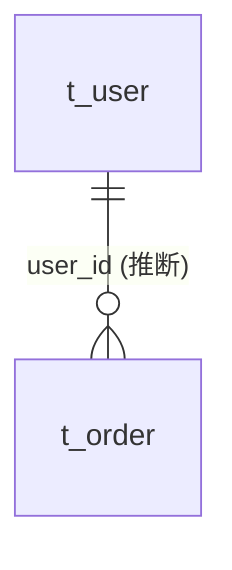

# 数据库设计文档模板

Structure for `02-数据库设计文档.md`.

````markdown
# {项目名称} 数据库设计文档

| 项目 | 内容 |
|---|---|
| 版本 | {version} |
| 数据库 | {MySQL 8.x 等，来自驱动依赖/DDL 方言；版本号不确定写【待确认】} |
| 字符集 | {来自 DDL，如 utf8mb4} |
| 表数量 | {N} |
| 数据来源 | {DDL 文件路径 / 实体类推断} |

## 1. 设计约定
{只写代码里真实存在的约定，例如：}
- 主键：{AUTO_INCREMENT / 雪花 ASSIGN_ID / UUID}
- 逻辑删除：字段 `deleted`，0 正常 1 删除（`@TableLogic` / mybatis-plus 全局配置）
- 审计字段：`create_time`、`update_time` 自动填充
- 乐观锁：`version` 字段（`@Version`）

## 2. 表清单

| 序号 | 表名 | 说明 | 对应实体 |
|---|---|---|---|

## 3. 表结构

### 3.1 t_user 用户表

| 字段名 | 类型 | 允许空 | 默认值 | 主键 | 说明 |
|---|---|---|---|---|---|

**索引**

| 索引名 | 类型 | 字段 |
|---|---|---|
| PRIMARY | 主键 | id |

## 4. 表关系



{逐条说明关系依据：外键约束 / JPA 关联注解 / 字段命名推断}

## 5. 一致性检查
{实体类与 DDL 的不一致：缺表、缺字段、类型不匹配。没有则写“未发现不一致”。}

## 附录：待确认事项
````

Notes:
- When a table exists only as an entity (no DDL), give the Java type and mark 类型 as `{Java 类型}（DDL 缺失，以实际库为准）`.
- When a column's comment is empty in DDL but the entity field has a Javadoc/description, use it and note the source. When both are empty, write `【待确认】`.
- Status-like columns: list the value meanings when the comment or an enum gives them.
